

<picture><source media="(prefers-color-scheme: dark)" srcset="assets/hero-dark.svg"></picture>

<picture><source media="(prefers-color-scheme: dark)" srcset="assets/social-l-dark.svg"></picture><a href="https://t.me/apcports2"><picture><source media="(prefers-color-scheme: dark)" srcset="assets/social-1-dark.svg"></picture></a><picture><source media="(prefers-color-scheme: dark)" srcset="assets/social-r-dark.svg"></picture>

<picture><source media="(prefers-color-scheme: dark)" srcset="assets/about-dark.svg"></picture>

<picture><source media="(prefers-color-scheme: dark)" srcset="assets/stack-dark.svg"></picture>

<a href="https://github.com/SameerAlSahab/Hydra-ESP"><picture><source media="(prefers-color-scheme: dark)" srcset="assets/project-hydra-esp-dark.svg"></picture></a>&nbsp;<a href="https://github.com/alibaba/open-code-review"><picture><source media="(prefers-color-scheme: dark)" srcset="assets/project-open-code-review-dark.svg"></picture></a>

<a href="https://github.com/SameerAlSahab/AppsPorter"><picture><source media="(prefers-color-scheme: dark)" srcset="assets/project-appsporter-dark.svg"></picture></a>&nbsp;<a href="https://github.com/SameerAlSahab/ProjectArcadeX"><picture><source media="(prefers-color-scheme: dark)" srcset="assets/project-projectarcadex-dark.svg"></picture></a>

<a href="https://github.com/SameerAlSahab/META-Verse"><picture><source media="(prefers-color-scheme: dark)" srcset="assets/project-meta-verse-dark.svg"></picture></a>&nbsp;<a href="https://github.com/SameerAlSahab/HP-Elitebook-1030-G2-X360-Hackingtosh-EFI"><picture><source media="(prefers-color-scheme: dark)" srcset="assets/project-hp-elitebook-1030-g2-x360-hackingtosh-efi-dark.svg"></picture></a>

<picture><source media="(prefers-color-scheme: dark)" srcset="assets/stats-dark.svg"></picture>

<picture><source media="(prefers-color-scheme: dark)" srcset="assets/streak-dark.svg"></picture>

<picture><source media="(prefers-color-scheme: dark)" srcset="assets/wave-dark.svg"></picture>

<a href="https://example.com"><picture><source media="(prefers-color-scheme: dark)" srcset="assets/button-1-dark.svg"></picture></a>&nbsp;&nbsp;<a href="https://github.com/SameerAlSahab?tab=repositories"><picture><source media="(prefers-color-scheme: dark)" srcset="assets/button-2-dark.svg"></picture></a>

<a href="https://metawka.github.io/expressive-profile/?from=SameerAlSahab"><picture><source media="(prefers-color-scheme: dark)" srcset="assets/credit-dark.svg"></picture></a>

